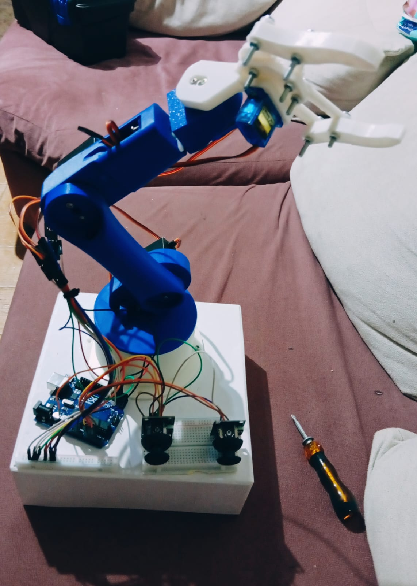
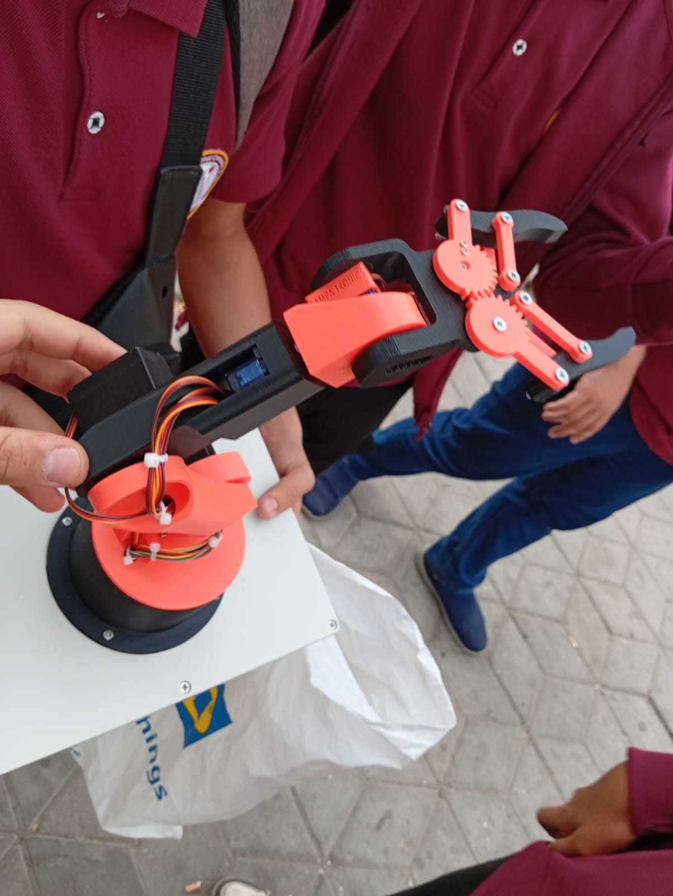
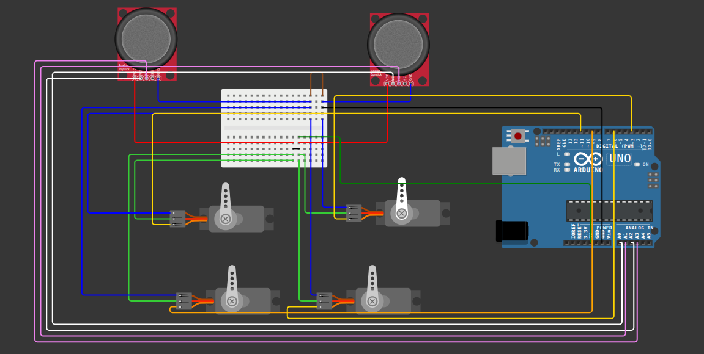
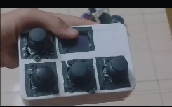

# Arm Robot

An Arduino-based robotic arm controlled with joysticks, later extended into a wireless mobile manipulator: a robotic arm mounted on a motorized chassis and driven by a handheld remote.

This was a school project, built as a team.

## My Role

I worked on the **hardware side** of the project: wiring the electronics and assembling the system.

> The mechanical parts (the arm structure and the chassis) were bought ready-made from the market. Our work was the electronics, the wiring, the control system, and putting everything together.

## Project Development

1. **Standard version (blue arm):** We first built the arm to meet the school's basic requirements. It uses an Arduino Uno, two analog joysticks, and four servo motors. The joysticks set the angles of the servos.
2. **Advanced version (mobile arm):** We then asked our practical-class instructor if we could submit a second, more advanced version. We mounted the arm on a motorized car chassis and built a handheld wireless remote to control it.

*Figure 1: The standard version, built to meet the school requirements.*

*Figure 2: The arm structure used for the advanced version.*

## Hardware

**Standard version**
- Arduino Uno
- 2 analog joysticks
- 4 servo motors
- 2x 3.7V Li-ion batteries

**Advanced version**
- Arm mounted on a motorized chassis
- Handheld remote with 4 joysticks and a small OLED display
- Wireless link using NRF modules

## Circuit Diagram

Wiring of the Arduino Uno, the two joysticks, and the four servo motors (standard version):

*Figure 3: Wiring diagram for the standard version.*

## Wireless Remote Controller

The handheld remote controls the mobile arm. It has four joysticks and a small display. **The remote worked successfully** and controlled both the arm and the chassis.

*Figure 4: The handheld remote.*

## Demo Video

The video below shows the remote controlling the arm on its mobile base (35 seconds):

[https://github.com/user-attachments/assets/ba8049cb-bd94-4756-b1bd-16d0d104609f]

## What I Learned

- Wiring joysticks, servo motors, and batteries to an Arduino
- How analog joystick input is converted into servo angles
- Building a wireless control link between a remote and a robot
- Working in a team and adding to a project beyond the basic requirements

## Notes

- The source code is not available at the moment.
- The wiring diagram shows the standard version (Arduino Uno, joysticks, servos). It does not include the wireless remote circuit.
